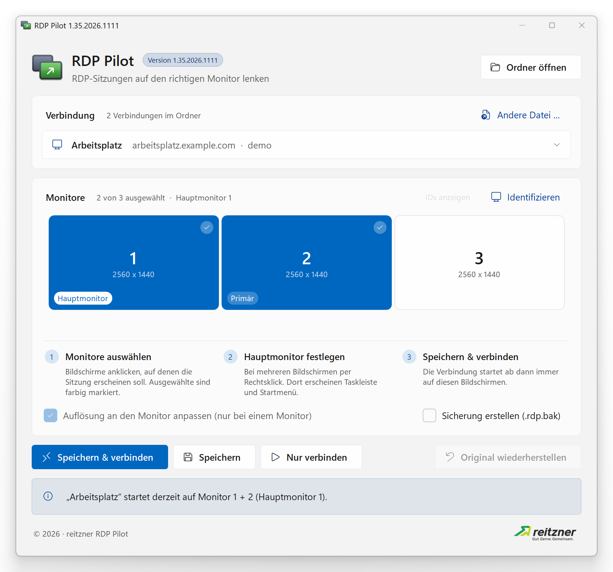
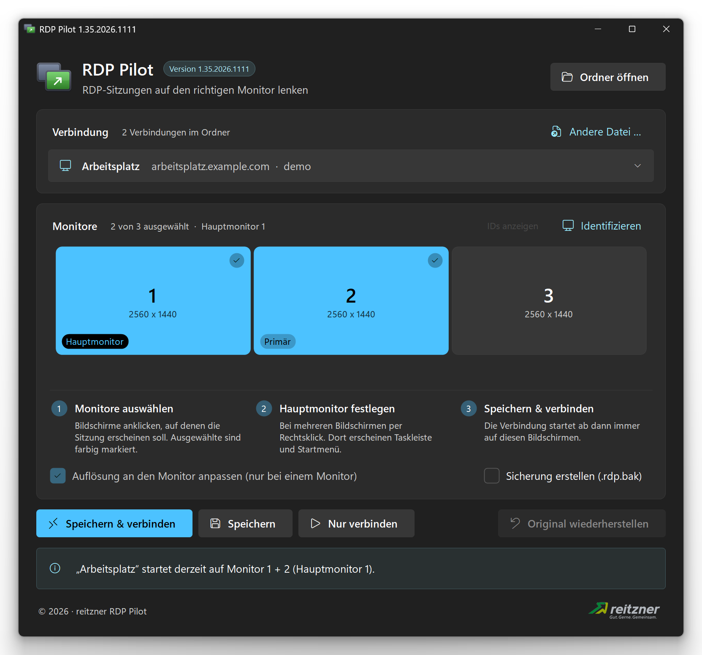
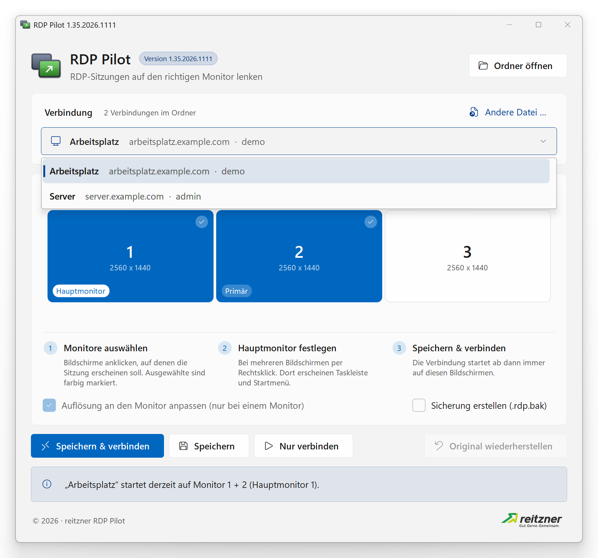
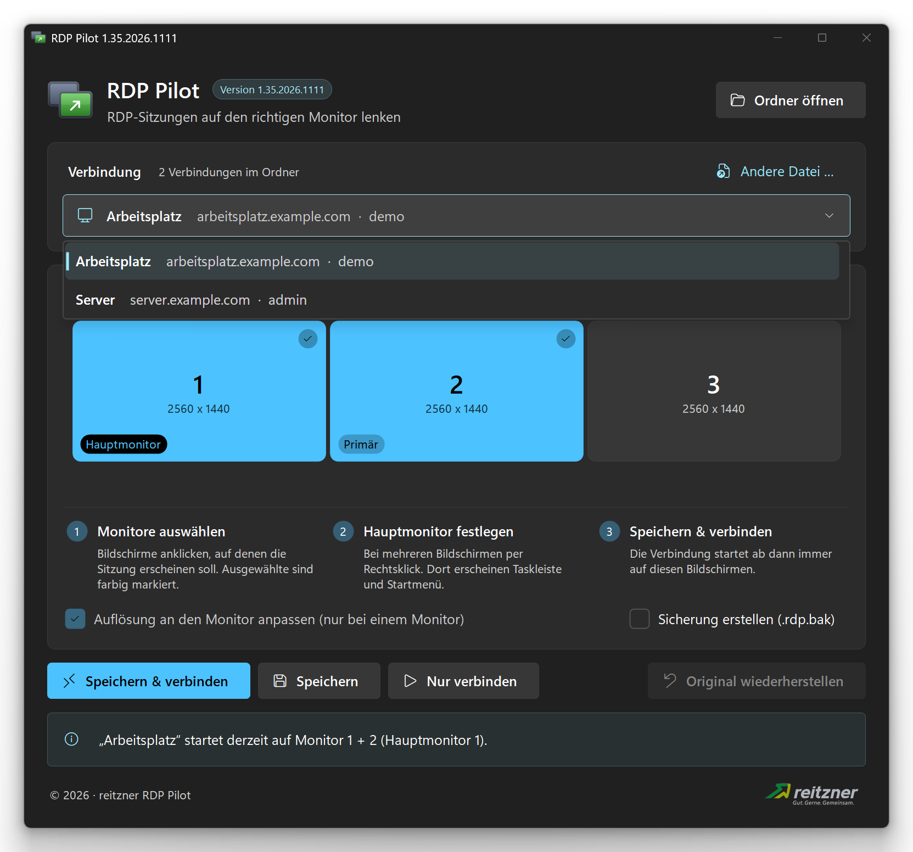
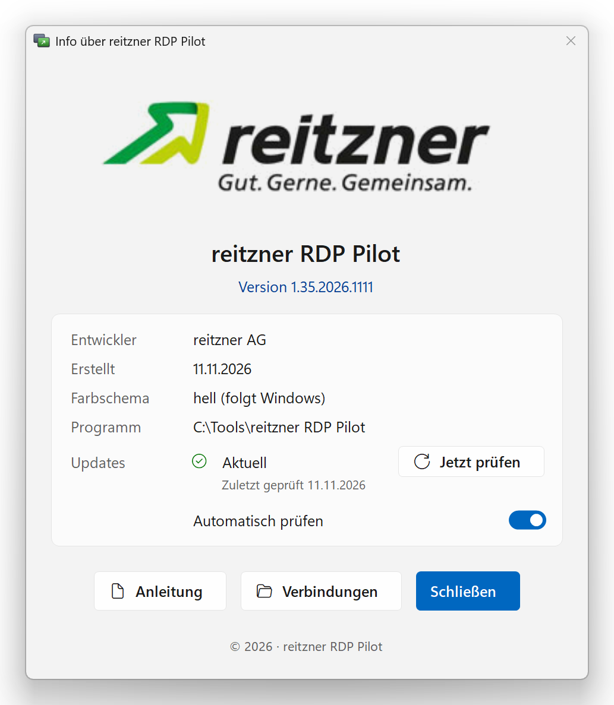
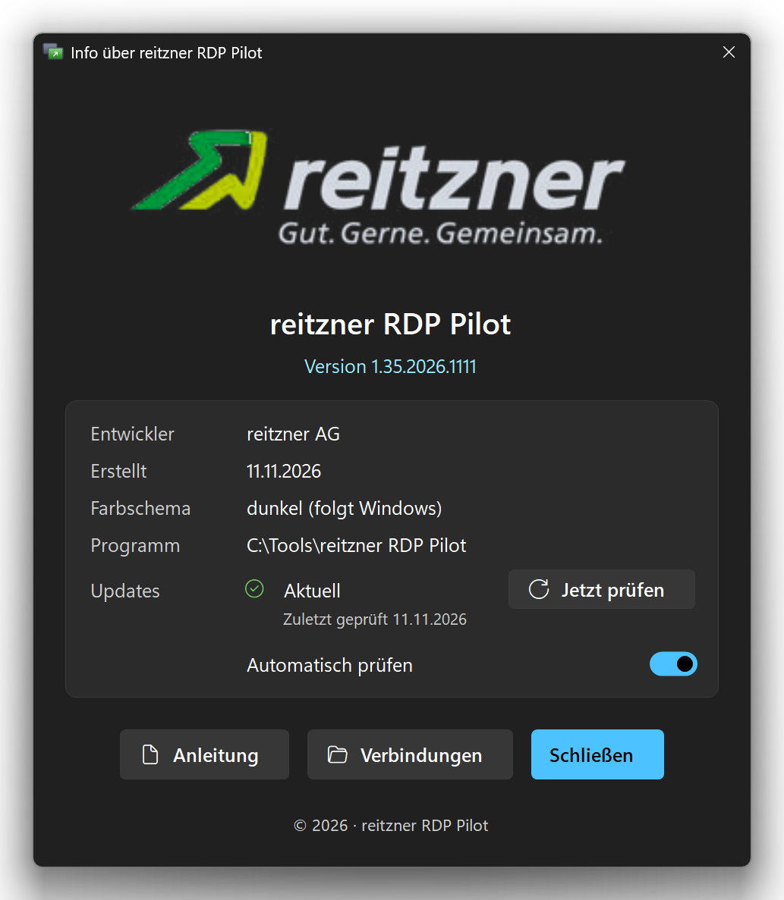

# reitzner RDP Pilot

**[English](#english) · [Deutsch](#deutsch)**

<table>
  <tr>
    <td></td>
    <td></td>
  </tr>
  <tr>
    <td align="center">Light · Hell</td>
    <td align="center">Dark · Dunkel</td>
  </tr>
</table>

<table>
  <tr>
    <td></td>
    <td></td>
  </tr>
  <tr>
    <td align="center">Connection list · Verbindungsliste</td>
    <td align="center">Connection list · Verbindungsliste</td>
  </tr>
</table>

<table>
  <tr>
    <td></td>
    <td></td>
  </tr>
  <tr>
    <td align="center">About · Info</td>
    <td align="center">About · Info</td>
  </tr>
</table>

Author / Autor: Günther Schoder · [www.westmc002.de](https://www.westmc002.de)

---

## English

Choose once on which monitor – or monitors – a Remote Desktop connection starts. RDP Pilot writes the setting directly into the connection file (`.rdp`), so the connection starts there every time, even when opened by double-click. RDP Pilot is not needed afterwards.

The interface is in **German**.

### Features

- **Monitor map** showing your screens in their real arrangement – click to select, click again to deselect
- **One or several monitors:** full screen on one monitor, or spanning several monitors (`use multimon`, `selectedmonitors`)
- **Main monitor** (taskbar and start menu of the remote session) chosen by right-click
- **Identify:** briefly shows each screen's number on the screen itself
- **Stays up to date:** detects changed screens (docking, undocking) and new or deleted connections in the folder, and warns when a connection is set to screens that are currently not attached
- **Connection list** with all `.rdp` files from the program folder, including server and user; other files via file dialog or drag & drop
- **Optional backup** of the original connection as `.rdp.bak`, restorable with one click
- **Command line** for shortcuts and scripts
- **Windows 11 design:** light/dark mode and Windows accent color, help texts on mouse-over
- **Update check:** shows at startup when a newer version is available on GitHub

### Installation

1. Download `reitzner-RDP-Pilot-<version>.zip` from the [Releases](https://github.com/WestMc002/reitzner-RDP-Pilot/releases).
2. Unzip it into a folder of its own with write access, ideally the folder that contains your connections (`.rdp` files).
3. Double-click `reitzner RDP Pilot.exe` to start. No installation needed.

Requirements: Windows 10 or 11 with .NET Framework 4.x.

### Command line

```
"reitzner RDP Pilot.exe" Test.rdp 2              only monitor 2
"reitzner RDP Pilot.exe" Test.rdp 2,1            monitors 1 + 2, main monitor 2
"reitzner RDP Pilot.exe" Test.rdp 2,1 /connect   set and connect
add /backup to save the original as .rdp.bak first
```

### Building from source

Run `Erstellen.bat` in the project folder. It compiles with the C# compiler of .NET Framework 4 (no other software needed), assigns the version number automatically (Major.Minor.Year.MonthDay) and backs up the project to `Backup`.

---

## Deutsch

Einmal festlegen, auf welchem Bildschirm – oder auf welchen Bildschirmen – eine Remotedesktop-Verbindung startet. RDP Pilot speichert die Einstellung direkt in der Verbindungsdatei (`.rdp`). Die Verbindung startet danach immer dort, auch per Doppelklick auf die Datei; RDP Pilot wird dafür nicht mehr gebraucht.

### Funktionen

- **Monitor-Karte** mit deinen Bildschirmen in ihrer echten Anordnung – anklicken wählt aus, erneuter Klick hebt die Auswahl auf
- **Ein oder mehrere Monitore:** Vollbild auf einem Monitor oder über mehrere Monitore (`use multimon`, `selectedmonitors`)
- **Hauptmonitor** (Taskleiste und Startmenü der Sitzung) per Rechtsklick festlegen
- **Identifizieren:** blendet auf jedem Bildschirm kurz seine Nummer ein
- **Bleibt aktuell:** erkennt geänderte Bildschirme (an- oder abgedockt) sowie neue oder gelöschte Verbindungen im Ordner und warnt, wenn eine Verbindung auf Bildschirme eingestellt ist, die gerade nicht angeschlossen sind
- **Verbindungsliste** mit allen `.rdp`-Dateien aus dem Programmordner, jeweils mit Server und Benutzer; weitere Dateien per Dateiauswahl oder Drag & Drop
- **Optionale Sicherung** der Originalverbindung als `.rdp.bak`, mit einem Klick wiederherstellbar
- **Kommandozeile** für Verknüpfungen und Skripte
- **Windows-11-Design:** heller/dunkler Modus und Windows-Akzentfarbe, Hilfetexte bei Mouseover
- **Update-Prüfung:** zeigt beim Start, wenn auf GitHub eine neuere Version bereitsteht

### Installation

1. `reitzner-RDP-Pilot-<Version>.zip` aus den [Releases](https://github.com/WestMc002/reitzner-RDP-Pilot/releases) herunterladen.
2. In einen eigenen Ordner mit Schreibrechten entpacken, am besten in den Ordner, in dem deine Verbindungen (`.rdp`-Dateien) liegen.
3. `reitzner RDP Pilot.exe` per Doppelklick starten. Eine Installation ist nicht nötig.

Voraussetzungen: Windows 10 oder 11 mit .NET Framework 4.x.

### Kommandozeile

```
"reitzner RDP Pilot.exe" Test.rdp 2              nur Monitor 2
"reitzner RDP Pilot.exe" Test.rdp 2,1            Monitor 1 + 2, Hauptmonitor 2
"reitzner RDP Pilot.exe" Test.rdp 2,1 /connect   setzen und verbinden
zusätzlich /backup: vorher Sicherung .rdp.bak anlegen
```

### Selbst kompilieren

`Erstellen.bat` im Projektordner starten. Sie kompiliert mit dem C#-Compiler des .NET Framework 4 (keine weitere Software nötig), vergibt die Versionsnummer automatisch (Haupt.Neben.Jahr.MonatTag) und sichert das Projekt unter `Backup`.

---

## Project structure / Projektaufbau

| Folder / file · Ordner / Datei | Content · Inhalt |
|---|---|
| `Quellcode` | C# source code · C#-Quellcode |
| `Resources` | icons and logo, embedded into the EXE · Icons und Logo, in die EXE eingebettet |
| `Screenshots` | images for this page (demo connection) · Bilder für diese Seite (Demo-Verbindung) |
| `Erstellen.bat` | build script · Build-Skript |
| `Liesmich.txt` | manual (German) · Anleitung (Deutsch) |

## License / Lizenz

GNU General Public License v3.0 or later · GNU General Public License v3.0 oder später – [LICENSE](LICENSE).

© 2026 Günther Schoder

**Exception / Ausnahme:** The reitzner logo (`Resources/Logo-hell.png`, `Resources/Logo-dunkel.png`) is a trademark of reitzner AG and excluded from the GPL. All rights reserved; it may only be redistributed unchanged together with this program. · Das reitzner-Logo (`Resources/Logo-hell.png`, `Resources/Logo-dunkel.png`) ist eine Marke der reitzner AG und von der GPL ausgenommen. Alle Rechte vorbehalten; es darf nur zusammen mit diesem Programm in unveränderter Form weitergegeben werden.

Remote Desktop and Windows are trademarks of Microsoft Corporation. This project is not affiliated with or endorsed by Microsoft. · Remotedesktop und Windows sind Marken der Microsoft Corporation. Dieses Projekt ist nicht mit Microsoft verbunden und wird nicht von Microsoft unterstützt.
